# Propuesta de UI: flujo de compra de TekaTeka

Revisión del 21 de noviembre de 2026, desde el celular de quien compra (390 px) y desde el escritorio (1440 px). El recorrido se hizo en producción sobre el evento de prueba [Test Noviembre 1](https://www.tekateka.com.ar/events/test-noviembre-1), con datos falsos y un comprobante de imagen de prueba. No se usó ninguna tarjeta ni se completó un pago de Mercado Pago: ese evento solo ofrece transferencia.

El panel del organizador no se pudo abrir porque no hay sesión de productor en esta revisión. Esa parte sale del formulario de alta y de la pantalla de ventas que ya están en el código, más la pared de login que sí se capturó.

Las capturas están en [`docs/ui-compras/`](ui-compras/).

## Los 8 cambios que más conviene hacer primero

Ordenados por ventas que se pueden recuperar contra el trabajo y el riesgo de tocarlos.

| # | Cambio | Impacto | Esfuerzo | Riesgo |
| --- | --- | --- | --- | --- |
| 1 | Mostrar el precio como `$ 12.000` y el total final (entrada + cargo TekaTeka + cargo de Mercado Pago) desde el primer paso | Alto | Bajo | Bajo |
| 2 | Después de transferir, decir la verdad: la entrada todavía no está, el QR llega cuando el productor confirma, y no mandar a crear una cuenta para "ver las entradas" | Alto | Bajo | Bajo |
| 3 | Arreglar la ficha para quien entra desde Instagram: hora en 24 h, dirección con mapa, texto del evento, política de cambios y un botón de compartir | Alto | Medio | Bajo |
| 4 | Preview de WhatsApp e Instagram con la foto del evento, un texto usable y una imagen de 1200×630 | Alto | Bajo | Bajo |
| 5 | No descontar cupo con una reserva que todavía no pagó, y mostrar siempre el alias en el paso del comprobante | Alto | Medio | Medio |
| 6 | Poder abrir la entrada con el enlace del mail, sin registrarse. Dejar "Mis entradas" en el menú del celular | Alto | Medio | Medio |
| 7 | Al crear el evento, no publicar las 00:00 por defecto, exigir lugar y texto, y copiar el link con el slug | Medio | Medio | Bajo |
| 8 | Lista de espera cuando se agota, y "agregar al calendario" cuando la compra queda hecha | Medio | Medio | Bajo |

El detalle de cada uno está más abajo, con la captura que lo muestra.

## Qué ya está bien y no hay que romper

Comprar no pide cuenta. Con nombre, mail y teléfono opcional se avanza. Se pueden llevar varias entradas (hasta 10, o el tope del evento) y hay código de promoción. Si el mismo mail vuelve a comprar, la app ofrece continuar la reserva pendiente. El mail de reserva incluye un enlace para retomar o cancelar durante 48 horas. En el escritorio la tarjeta de compra queda fija al hacer scroll. La home tiene una jerarquía clara: una selección y después el resto, con precio y un botón "Comprar entradas". El aviso de revisar spam está. Hay un formulario de ayuda en la misma ficha.

## Cómo se recorrió

1. Home y menú del celular.
2. "Ver eventos disponibles", que abre Espacios y no un listado plano.
3. Ficha de Test Noviembre 1.
4. Datos de prueba, 1 y 2 entradas.
5. Revisión y elección de transferencia (única opción).
6. Carga de un PNG de prueba y pantalla de "compra pendiente".
7. "Ver mis entradas", que cae en el login.
8. Términos, ayuda y login del organizador, sin entrar.

Mercado Pago no apareció en este evento. El comportamiento de la vuelta del pago (éxito, pendiente, fallo) está descripto a partir del código de `PurchaseFlow`, no de una pantalla real.

### Reservas de prueba para anular

Estas compras quedaron pendientes y **descuentan cupo**. Conviene cancelarlas desde el panel:

| Mail | Qué pasó |
| --- | --- |
| `prueba.ux.mobile.1795295050092@example.com` | 2 entradas. La pantalla se quedó en "Procesando..." y se cortó la espera; el cupo igual bajó. Puede no tener comprobante. |
| `prueba.ux.desktop.1795295107784@example.com` | Igual que la anterior, 2 entradas. |
| `prueba.ux.final.mobile.1795295218188@example.com` | 1 entrada, con comprobante de prueba. |
| `prueba.ux.final.desktop.1795295229496@example.com` | 1 entrada, con comprobante de prueba. |

Al empezar el recorrido el evento decía 99 disponibles de 100. Al terminarlo, 94. Esas reservas de prueba explican la diferencia, y también muestran el problema del cupo (punto 5).

## Recorrido del comprador

### Home

En el celular la home funciona: el título se lee, el botón ocupa el ancho y las tarjetas apilan una foto, la fecha, el lugar, el precio y "Comprar entradas". En el escritorio la selección de tres eventos y la grilla se entienden de un vistazo.

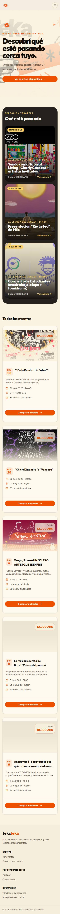

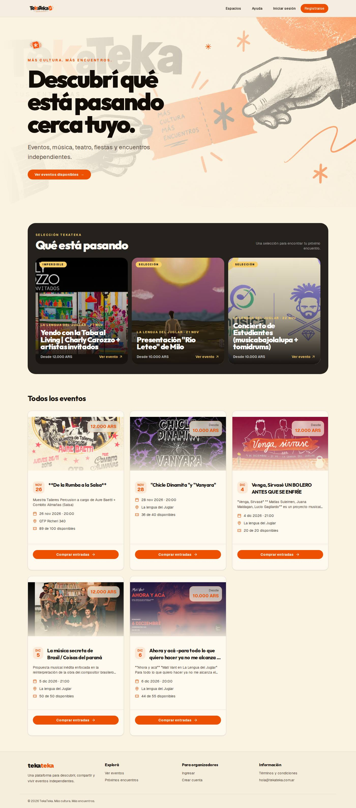

El precio sale como `12.000 ARS` y `10.000 ARS`. En la Argentina la gente lee `$ 12.000`. El formateo usa el locale `es-ES` con moneda `ARS`, y por eso el número queda adelante y las letras "ARS" atrás. Es un cambio chico en `formatCurrency` (pasar a `es-AR`) y se ve en toda la plataforma: home, ficha, revisión, mail no, porque el mail arma el monto por otro lado.

El menú del celular ofrece Espacios, Ayuda, Iniciar sesión y Registrarse. No hay "Mis entradas". Quien ya compró y vuelve desde Instagram no tiene por dónde entrar a su QR.

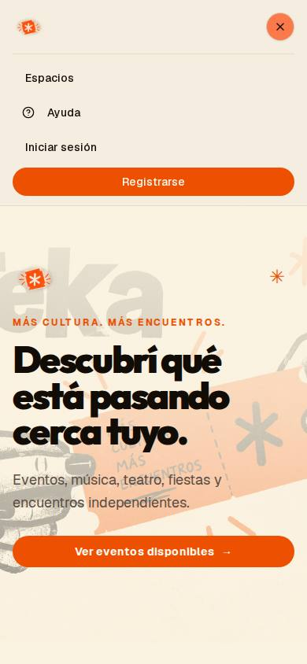

"Ver eventos disponibles" no muestra eventos. Muestra espacios, y hay que elegir un lugar para ver la agenda. Para quien llega al link del evento desde Instagram no molesta. Para quien entra por la home o por el botón de la marca, suma un paso antes de ver un precio.

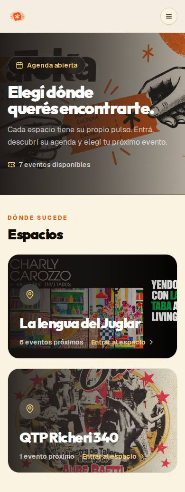

La home en esta pasada tardó unos 4 segundos en entregar el HTML, medida desde un servidor fuera de la Argentina. La página es `force-dynamic` y baja varias fotos grandes una debajo de la otra. No reemplaza una medición en 4G de un celular real, pero en un link de historia de Instagram cada segundo de foto pesada se nota.

### Ficha del evento

La ficha de prueba es el peor caso de confianza, y el formulario del organizador la deja publicar así.

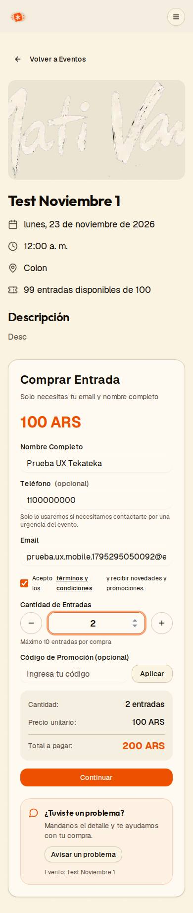

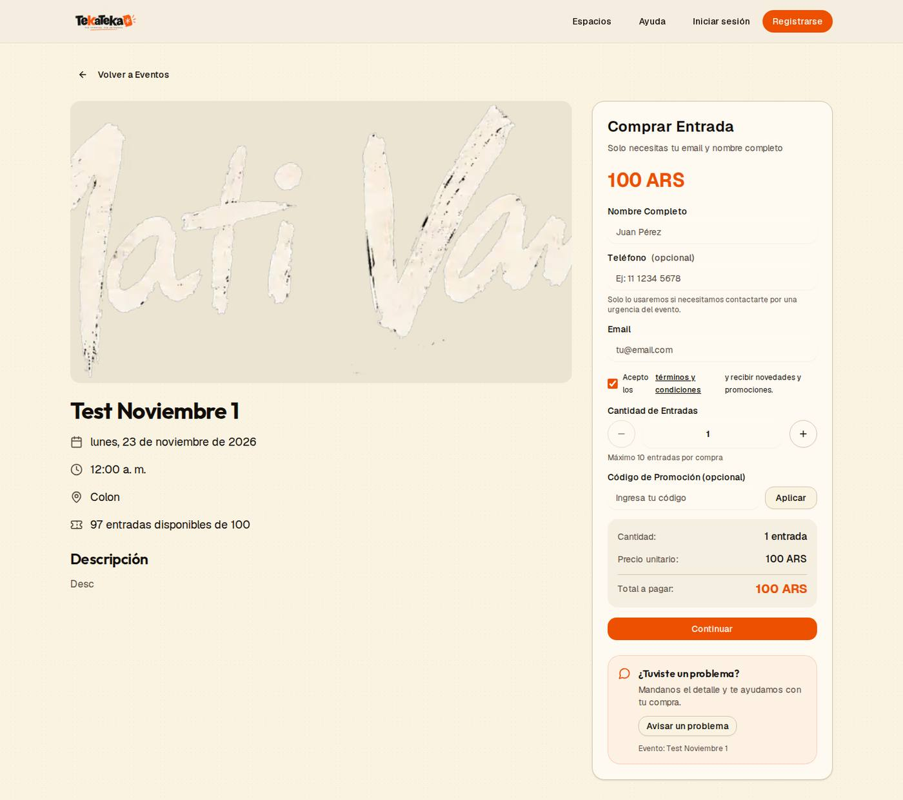

Lo que ve quien está por pagar $ 100 (o $ 12.000 en un show de verdad):

- La hora dice **12:00 a. m.** El alta guarda `00:00` si nadie toca la hora, y la ficha la muestra en formato de 12 horas. En un show de las 21 hs, "9:00 p. m." también se entiende peor que "21:00".
- El lugar es la palabra **Colon**. No hay dirección, no hay botón de mapa. El campo "Ubicación en Google Maps" existe en el alta y el mail de la entrada sí arma un link, pero la ficha no lo usa.
- La descripción es **Desc**. No hay quién toca, duración, edad ni qué incluye la entrada.
- Dice **99 entradas disponibles de 100** (y después 94). Publicar el cupo lleno al lado de las vendidas le dice a la sala que no fue nadie. Cuando quedan pocas, el número ayuda. Cuando sobran, resta.
- El checkbox de términos viene **marcado** y en la misma frase acepta condiciones y el envío de novedades. En el escritorio, además, la frase se parte mal ("Acepto los / términos y condiciones / y recibir novedades").
- No hay botón para compartir por WhatsApp ni para guardar la fecha.
- Los términos dicen que cambios y devoluciones "se rigen por las condiciones informadas para cada evento". En la ficha no hay ningún lugar donde esas condiciones se informen.

El formulario en sí es corto, y eso está bien: nombre, teléfono opcional, mail, cantidad, código. El total de ese primer paso dice "Total a pagar: 200 ARS" por 2 entradas. El cargo de servicio de TekaTeka y el 10 % de Mercado Pago se calculan recién en la revisión, y solo si son mayores a cero. En este evento el cargo dio 0, entonces el número coincidió. En un evento con cargo, la persona acepta un total y en el paso siguiente el número cambia. Ese es un lugar clásico para abandonar, o para discutir después.

### Revisión y pago

El paso se anuncia como "Paso 2 de 2". Después hay por lo menos un paso más (subir el comprobante) y, si fuera Mercado Pago, la ida al checkout. El mail largo se corta en dos líneas y en el celular queda apretado contra el borde.

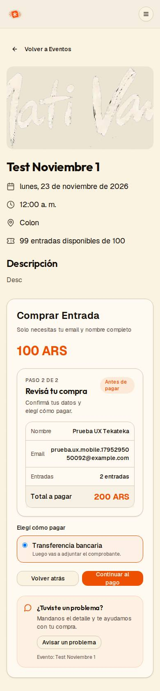

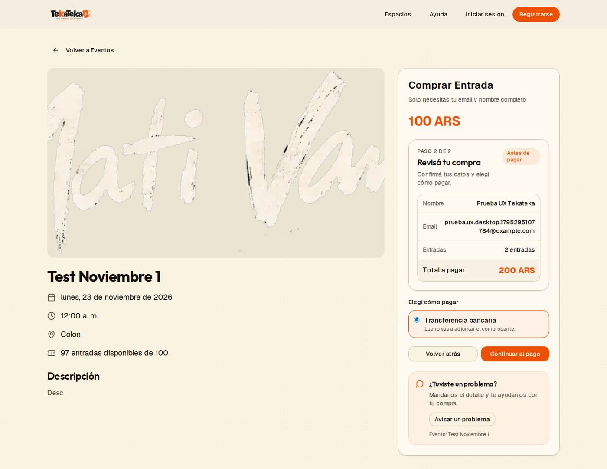

"Continuar al pago" tardó entre 3 y 4 segundos en abrir el paso del comprobante. En un intento anterior, a los 4 segundos seguía diciendo "Procesando..." y el cupo ya se había descontado: la reserva se crea en el servidor antes de que la pantalla avance. Si la persona cierra porque "no pasa nada", la entrada queda tomada.

### Transferencia y comprobante

El botón "Pagar" de una transferencia no muestra los datos para transferir si el evento no tiene alias y titular cargados. En Test Noviembre 1 la pantalla pasó directo a "subí el comprobante", sin alias, sin nombre de la cuenta y sin monto destacado afuera del recuadro chico. El control del archivo está en inglés: "Choose File / No file chosen".

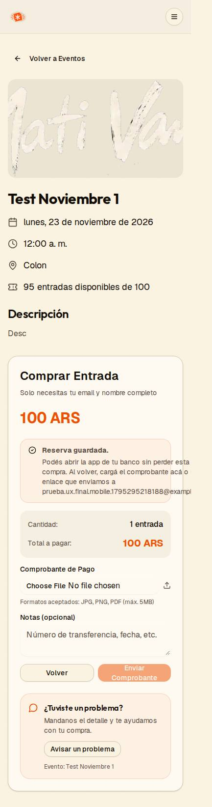

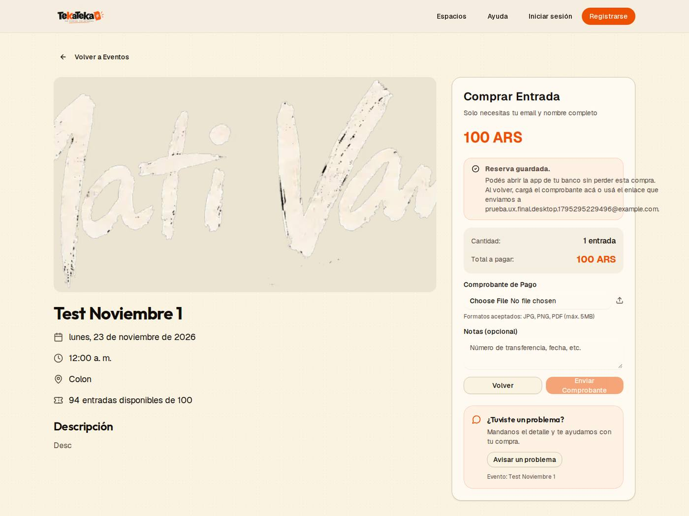

"Volver" regresa al formulario y no cancela la reserva. La persona puede creer que deshizo la compra. El cupo sigue ocupado hasta que alguien cancele, o hasta que use el enlace de "no voy a comprar" que solo está en el mail.

El archivo de prueba se subió en alrededor de 1 segundo y la pantalla pasó a pendiente. Hasta ahí el mecanismo funciona.

### Después de pagar

La pantalla mezcla dos mensajes. El título es "Compra pendiente de confirmación" y el texto pide que el organizador verifique. Abajo dice "Te enviamos la información de tus entradas por correo", que suena a que el QR ya salió. El mail que realmente se manda en este momento (está en `create-ticket`) tiene asunto "Reserva pendiente", sale como **TKTK Entradas** desde `notificaciones@tktk.buholabs.com.ar`, y aclara que la entrada todavía no está confirmada. El mail con el QR sale después, con otro remitente (**TekaTeka**), solo cuando el pago queda aprobado.

Quien no encuentra el mail ve un check, un precio otra vez, y dos botones: "Ver mis entradas" y "Crear cuenta".

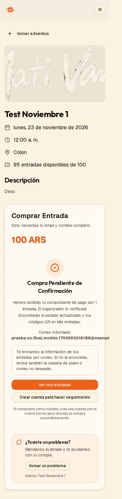

"Ver mis entradas" no muestra entradas. Pide contraseña.

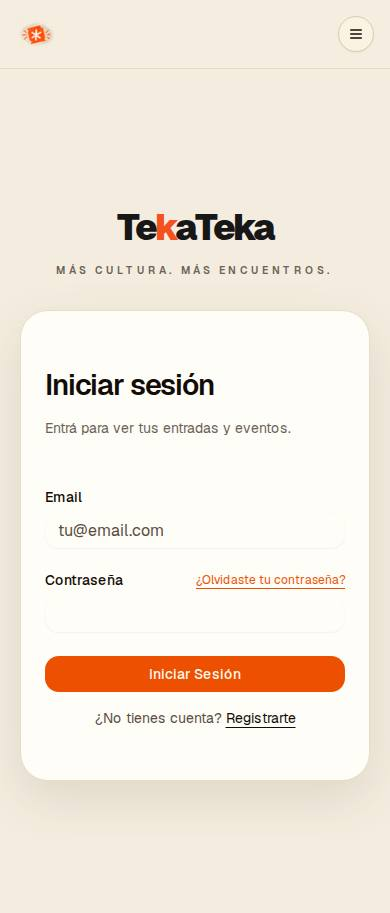

Para que una compra de invitado aparezca en Mis entradas hace falta una cuenta con el mismo mail **y el mail confirmado**. Hasta que eso pasa, la consulta filtra por `buyer_id` y el invitado ve "No tienes entradas aún", en tuteo. El QR público existe en `/ticket/[codigo]`, pero esa URL no se muestra en esta pantalla.

En el código, la vuelta de Mercado Pago tiene tres estados por query (`payment=success`, `pending`, `failure`):

- Éxito y pendiente los dos abren la misma pantalla con un check y el título "Pago recibido". El pendiente queda escondido en un alerta. Alguien puede irse a la puerta creyendo que ya está.
- El fallo guarda el mensaje, pero ese mensaje solo se dibuja en el paso de pago. Al volver a la ficha el paso vuelve a ser el formulario, así que el "el pago no se completó" no se ve.
- El botón de Mercado Pago abre `target="_blank"`. En el celular eso suele ser otra pestaña, y la pestaña original se queda en "pagá".

No se pudo confirmar esto en el checkout real porque el evento de prueba no ofrece Mercado Pago. Para el organizador común, Mercado Pago figura como "en pruebas" y deshabilitado; la alternativa es un link externo que la app no puede confirmar sola.

### Mail, reenvío y Mis entradas

No se pudo abrir la casilla `example.com`. Lo que el producto manda, según el código:

- Al reservar: un solo mail por compra, con código de reserva, total, alias si existe, enlace para subir el comprobante o seguir a Mercado Pago, y enlace para cancelar. Dura 48 horas.
- Al confirmar: otro mail, con fecha, mapa y un QR por entrada. El reenvío está en `/api/resend-ticket` y lo dispara el organizador, no el comprador.
- El comprador no tiene en la ficha un "reenviar mi entrada". Tiene que escribir a soporte o crear una cuenta.

La página de ayuda existe y explica la transferencia, pero es una guía larga para organizadores mezclada con preguntas de compradores. Desde el menú de quien compra no se entiende si es para él o para el productor.

## Vista del organizador

Sin usuario de productor, el panel redirige al mismo login de los compradores. No dice que ahí se administran eventos.

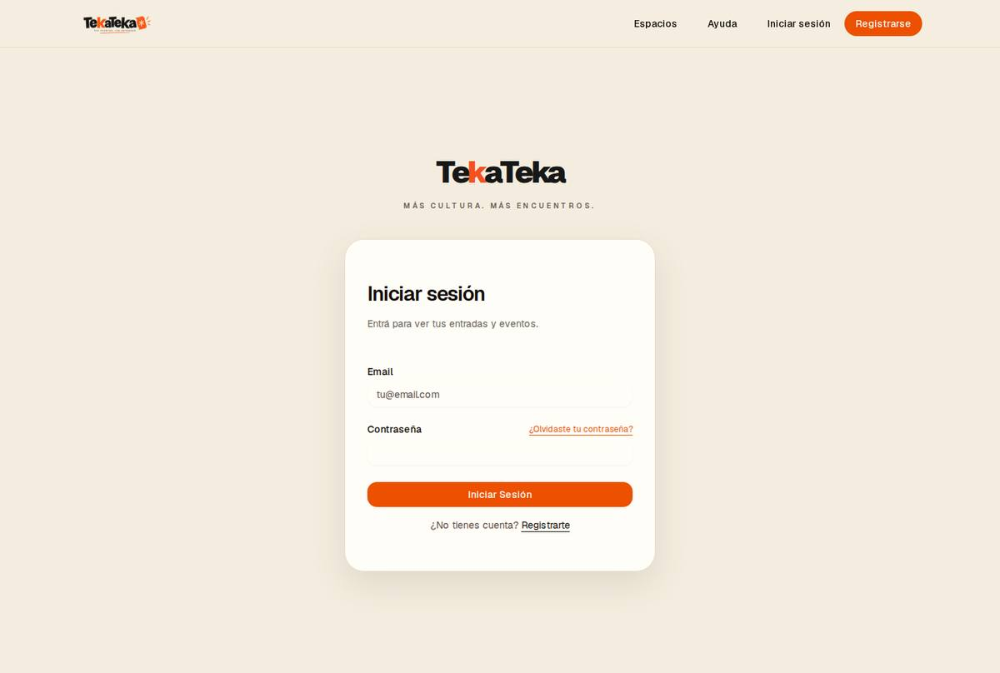

Lo que el alta le pide a alguien que quiere publicar un show chico, en una sola pantalla larga:

- Título, descripción (opcional, y por eso puede publicarse "Desc"), y **tres estilos obligatorios**.
- Fecha, y hora que arranca en `00:00` con pasos de 10 minutos.
- Espacio elegido de un catálogo. Si el catálogo está vacío, un texto libre. El mapa es opcional y después no se muestra en la ficha.
- Precio, precio en puerta, cupo total, tope por persona.
- Medios de pago. Mercado Pago deshabilitado salvo superadmin. Transferencia con alias y titular, que si se dejan vacíos la ficha igual se publica.
- Link de Mercado Pago externo, con un aviso de que hay que confirmar a mano. Correcto, pero fácil de cargar creyendo que es automático.
- Tipos de entrada, solo en el alta. Después se editan en otra pantalla.
- Imagen obligatoria, idealmente 16:9 y 1200 px. Sin eso no se puede crear el evento. El encuadre se puede ajustar, y eso se nota en la ficha de prueba: se ve un recorte de un logo, no un afiche.

Cuando el evento se crea, hay una tarjeta para copiar el link. Esa tarjeta arma `/events/{id}` con el UUID, aunque el evento tenga slug. El botón "Copiar link" del listado sí usa el slug. Dos links distintos para el mismo show.

El listado del panel ya separa confirmadas y pendientes, y la pantalla de ventas de un evento tiene la tabla, la liquidación y el link para la persona de la puerta. Eso está bien encaminado. Lo que le falta al productor de una sala chica es ver la ficha como la va a ver el público **antes** de publicar, y enterarse en el momento de que faltan el mapa, la hora y el texto.

## Confianza, compartir y accesibilidad

**Open Graph del evento de prueba**, leído del HTML:

| Campo | Valor |
| --- | --- |
| `og:title` | Test Noviembre 1 |
| `og:description` | Desc |
| `og:image` | un `.webp` del storage, el recorte del logo |
| `og:type` | vacío |
| `twitter:image` | el logo horizontal de TekaTeka, no la foto del evento |
| canonical | no hay |

WhatsApp usa `og:image` y `og:description`. Una historia de Instagram que pega el link va a previsualizar "Desc" y un logo cortado, no el afiche. El logo de la marca es 2048×768: en una tarjeta de link se recorta mal. Conviene una imagen JPG o PNG de 1200×630 generada con la foto del evento, el título, la fecha y el lugar, y un texto de respaldo cuando la descripción tiene menos de una oración.

**Accesibilidad básica**, de lo que se ve en estas pantallas:

- El `lang` de la página es `es`. Los campos del formulario tienen etiqueta. Los botones de sumar y restar entradas tienen nombre. El menú del celular también.
- El control de archivo queda en inglés.
- El check verde de "pendiente" se lee como éxito.
- Los mails largos se parten y se salen del renglón.
- Hay tuteo mezclado con voseo: "Selecciona el tipo de entrada", "No tienes entradas aún", "¿No tienes cuenta?", "Has reservado", al lado de "Descubrí" y "podés".
- No hay un enlace para saltar al contenido. En una ficha larga, desde el teclado se recorre toda la navbar antes del formulario.

Nada de esto bloquea una compra. El tuteo y el check verde sí generan dudas en el momento de pagar.

## Lista priorizada completa

Impacto: cuánto puede cambiar las ventas o las entradas que se pierden después de pagar. Esfuerzo: tamaño del cambio en la app actual. Riesgo: chance de romper un cobro o un cupo que hoy funciona.

| Cambio | Impacto | Esfuerzo | Riesgo | Notas |
| --- | --- | --- | --- | --- |
| Precio en `$` con locale `es-AR`, igual en la web y en los mails | Alto | Bajo | Bajo | Se ve en todas las capturas. Un solo helper. |
| Total con cargos en el primer paso, y el mismo número en la revisión | Alto | Bajo | Bajo | Hoy el primer "total a pagar" puede no incluir el cargo de servicio ni el 10 % de Mercado Pago. |
| Copiar de la pantalla de pendiente: "tu entrada no está confirmada; el QR llega cuando el productor aprueba el comprobante" | Alto | Bajo | Bajo | Hoy contradice al mail de reserva. |
| Sacar "Ver mis entradas" como camino principal si no hay sesión. Mostrar el mail y el código de reserva en la pantalla | Alto | Bajo | Bajo | El botón actual cae en un login que no explica la compra. |
| Vuelta de Mercado Pago: pendiente distinto de aprobado, y el fallo visible al volver a la ficha | Alto | Bajo | Medio | No se pudo ver en este evento. El fallo hoy no se renderiza en el paso en el que aterriza la persona. |
| Hora en 24 h y aviso si queda en 00:00 | Alto | Bajo | Bajo | "12:00 a. m." está publicado en el evento de prueba. |
| Mapa y dirección en la ficha, usando el link que el organizador ya puede cargar | Alto | Bajo | Bajo | El mail ya lo tiene. La ficha no. |
| Descripción mínima y una línea de cambios/devoluciones por evento | Alto | Medio | Bajo | Los términos delegan en "lo informado en el evento" y el evento no informa nada. |
| Botón compartir (WhatsApp) y imagen Open Graph de 1200×630 con foto, fecha y lugar | Alto | Medio | Bajo | Es el canal por el que entra la mayoría. |
| No contar como vendida una reserva sin pago. Liberar el cupo al vencer el enlace de 48 h, o al tocar "Volver" si todavía no hay comprobante | Alto | Medio | Medio | Toca inventario. Hay que alinear el conteo de la ficha, la home y la puerta. |
| Alias y titular obligatorios si el medio es transferencia, y visibles en el paso del comprobante con el monto para copiar | Alto | Bajo | Bajo | En este evento no se mostraron. |
| Entrada por enlace del mail, sin cuenta. "Mis entradas" en el menú, y un "reenviar a este mail" para el comprador | Alto | Medio | Medio | Hoy el reenvío lo hace el organizador y Mis entradas exige cuenta confirmada. |
| Un solo remitente, TekaTeka, en un dominio de tekateka.com.ar | Alto | Medio | Medio | Hoy conviven "TKTK Entradas" y `tktk.buholabs.com.ar`. Eso empuja el mail a spam justo cuando la persona busca el QR. |
| Alta del organizador: preview de la ficha, slug en el primer link que se copia, Mercado Pago explicado antes de publicar | Medio | Medio | Bajo | El link de creación usa el UUID. El del listado usa el slug. |
| Barra fija en el celular: "Conseguir entrada · $ 100", arriba del pliegue de la foto | Medio | Bajo | Bajo | En el escritorio la tarjeta ya es fija. En el celular la compra queda debajo de la foto y los datos. |
| "Choose File" en castellano, y la frase de términos en una sola oración, con el marketing en otro checkbox sin marcar | Medio | Bajo | Bajo | El consentimiento de novedades hoy viene aceptado junto con los términos. |
| Lista de espera en agotado, con mail cuando se libera un cupo | Medio | Medio | Bajo | Hoy el agotado es un texto y se termina la venta. |
| Agregar al calendario (Google y archivo .ics) en la ficha y en el mail confirmado | Medio | Bajo | Bajo | Ayuda a que la gente vaya, que también es venta de la sala. |
| Home: el botón principal lleva a una agenda de eventos, y Espacios queda como filtro | Medio | Medio | Bajo | Quien ya tiene el link del show no pasa por acá. |
| Unificar el voseo en botones, mails y estados vacíos | Bajo | Bajo | Bajo | No vende solo, pero la mezcla se nota en el login y en Mis entradas. |
| Estado de "Procesando" con una frase ("estamos guardando tu reserva") y el botón deshabilitado de forma visible más de un segundo | Bajo | Bajo | Bajo | A los 3 o 4 segundos parece que se colgó, y la reserva a veces ya existe. |
| Separar la ayuda de compradores de la guía del productor | Bajo | Bajo | Bajo | La página actual sirve, mezclada. |

## Qué no entra en esta propuesta

No hace falta rediseñar la home. La voz visual (crema, negro, naranja) ya se reconoce y las tarjetas se leen. Tampoco hace falta obligar a registrarse para comprar: eso ya está resuelto y es una ventaja contra otras ticketeras. El trabajo está en que el número, el lugar y el "¿ya está mi entrada?" no hagan dudar a alguien que llegó con el dedo desde una historia.
